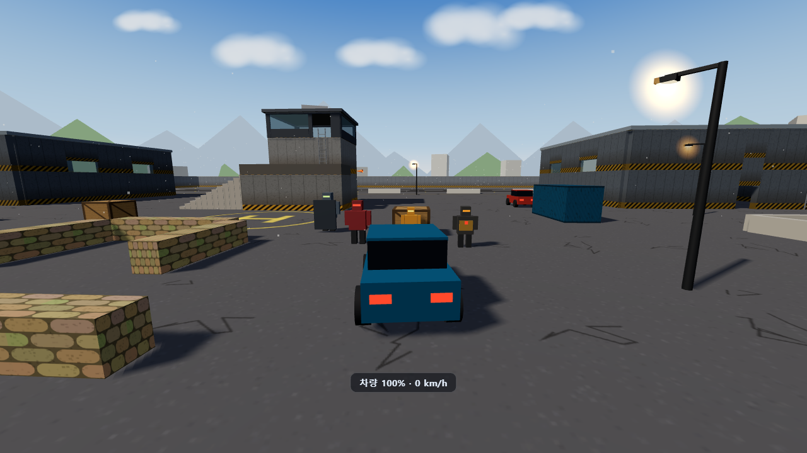
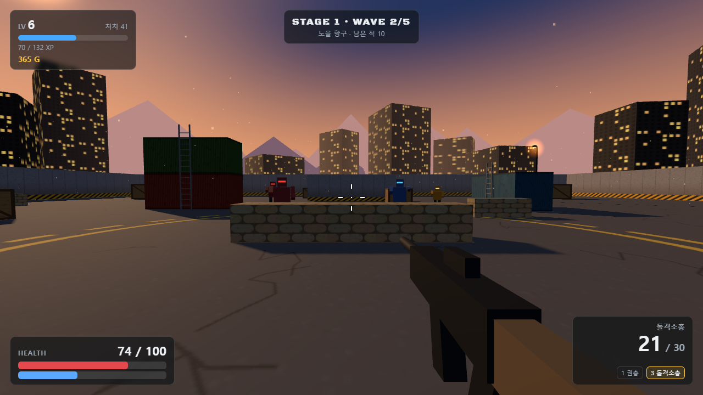
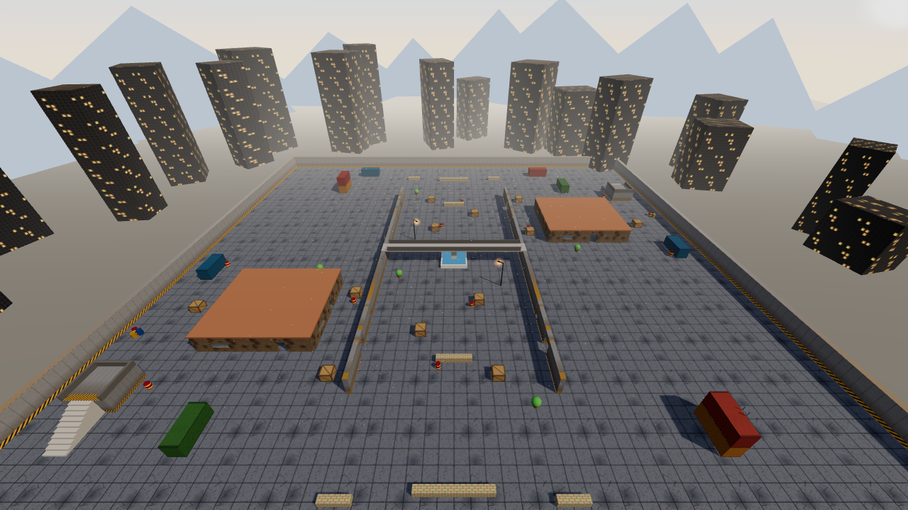
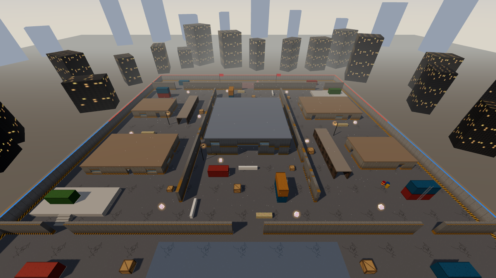
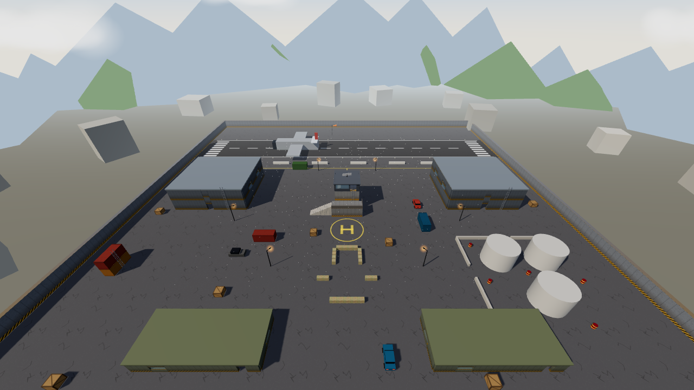
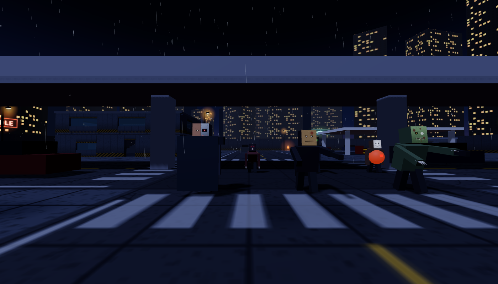
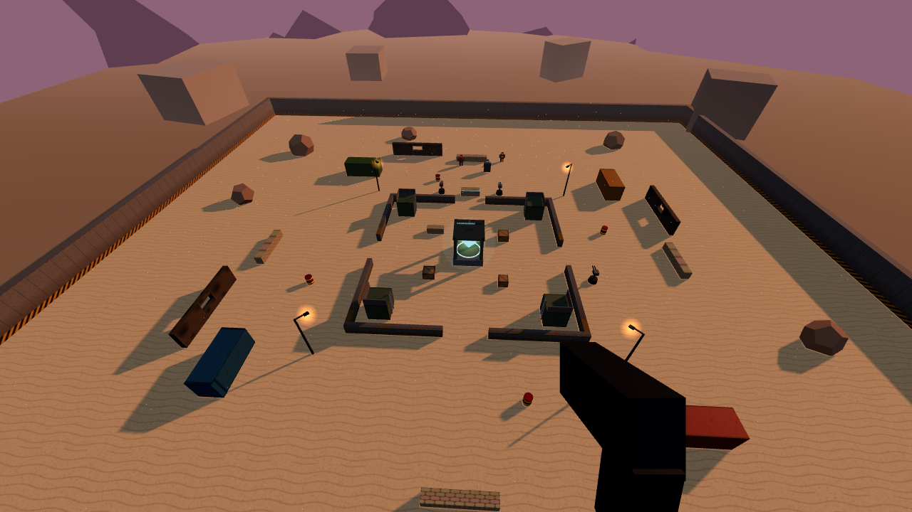
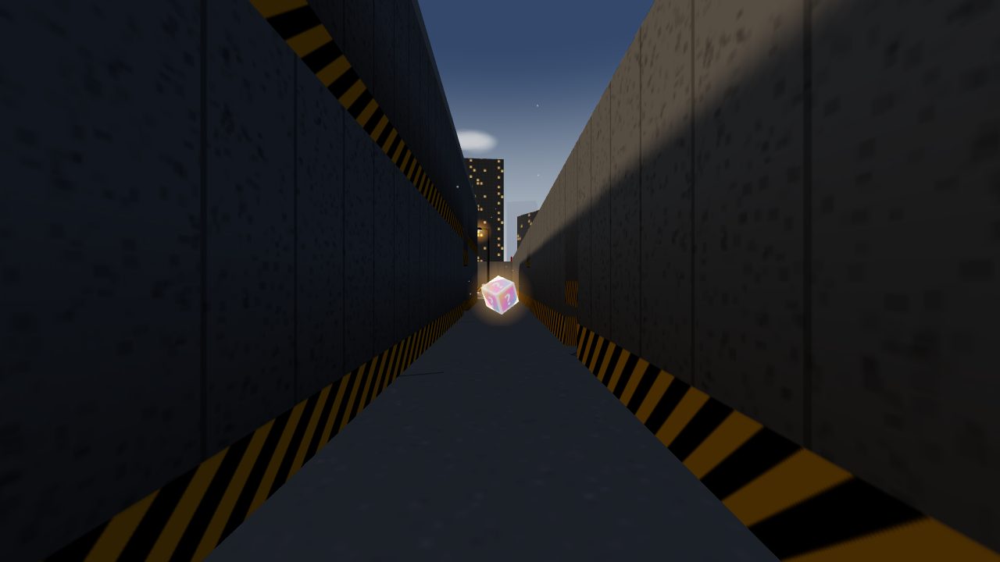

# IRON WAVE

**버티고, 성장하고, 돌파하라.**

웨이브를 버티며 성장하는 FPS 서바이벌 게임이에요. 설치 없이 PC와 모바일 브라우저에서 바로 할 수 있고, 친구와 1 대 1, 2 대 2 대전도 할 수 있어요.

## ▶ [지금 플레이하기](https://choiyoonsou.github.io/iron-wave/)

## 게임 방식

한 판은 여섯 전장을 차례로 돌파하는 작전이에요. 웨이브를 버티면서 캐릭터를 키우고, 마지막 비행장의 최종 보스를 쓰러뜨리면 엔딩을 볼 수 있어요.

1. **캐릭터와 난이도를 고르세요.** 캐릭터 4명은 패시브 능력과 궁극기가 각각 달라요. 난이도는 **쉬움, 보통, 어려움** 중에 고르고, 어려울수록 적이 많고 세지고 회복이 줄어요.
2. **웨이브를 버티세요.** 엄폐물을 쓰고, 높은 곳에 올라가고, 계속 움직이세요. 유리창은 쏘면 깨지고 화약통은 쏘면 터져요. 차를 타고 적을 들이받을 수도 있어요.
3. **레벨업하세요.** 레벨업할 때마다 **강화 카드 3장 중 1장**을 골라요. 데미지, 연사 속도, 흡혈, 치명타, 자동 회복 등이 있어서 매 판 다른 빌드가 만들어져요.
4. **웨이브 사이에 상점을 이용하세요.** 새 무기를 사거나, 가진 무기를 강화하거나, 방탄 조끼, 구급상자, 수류탄을 살 수 있어요.
5. **보스를 쓰러뜨리세요.** 스테이지마다 5번째 웨이브에 그 전장의 보스가 나와요. 보스를 잡으면 다음 전장으로 넘어가요.
6. **엔딩, 그다음은 무한 모드.** 6스테이지를 깨면 엔딩이 나와요. 원하면 **무한 모드**로 이어서, 점점 강해지는 적을 상대로 기록에 도전할 수 있어요.

| 상점 | 레벨업 |
|---|---|
|  |  |

## 캐릭터

| 캐릭터 | 역할 | 패시브 | 궁극기 |
|---|---|---|---|
| 레이븐 | 돌격 | 재장전 속도 +15% | **오버드라이브:** 8초간 연사 +80%, 탄약 무한, 이동 속도 +30% |
| 타이탄 | 탱커 | 최대 체력 +25 | **아이언 월:** 즉시 체력 50 회복, 6초간 받는 피해 70% 감소 |
| 블레이즈 | 폭파 | 수류탄 +1개, 최대 5개 | **폭격 요청:** 조준한 곳에 폭탄 6발 |
| 고스트 | 정찰 | 이동 속도 +10% | **헌터 비전:** 8초간 벽 너머 적이 보이고 데미지 +25% |

궁극기는 시간이 지나거나 적을 맞히면 충전돼요.

## 전장

전장마다 생김새뿐 아니라 **구조와 싸우는 방식**이 달라요.

| 1. 노을 항구 | 2. 사막 기지 | 3. 폐허 도시 |
|---|---|---|
|  |  |  |
| 컨테이너 미로, 9.6m 높이 크레인, 계단으로 올라가는 화물선 | 성벽 요새(성벽 위 통로, 망루 4개, 개구멍), 바위 능선, 오아시스 | 비 내리는 밤. 고가도로, 2층 사무실, 주유소, 공사장 비계 |

| 4. 구시가지 | 5. 물류 센터 | 6. 비행장 (마지막) |
|---|---|---|
|  |  |  |
| 긴 벽으로 나뉜 세 갈래 길, 들어갈 수 있는 건물, 구름다리, 앉아서 지나가는 개구멍 | 벽으로 막힌 실내 위주 맵. 지붕 있는 큰 창고(선반 통로, 2층 통로), 좁은 복도, 사무동, 터널 | 가장 넓은 맵. 활주로와 수송기, 격납고, 관제탑, 연료 탱크. 차를 타고 달리기 좋아요 |

### 전장에서 할 수 있는 것
- **유리창:** 한 발에 깨지고, 깨진 창으로 쏘거나 넘어갈 수 있어요.
- **화약통**(노란 띠가 있는 빨간 통): 쏘면 터져서 주변 적과 **나에게도** 피해를 줘요. 옆 화약통도 연달아 터져요.
- **자동차:** 차를 타고 적을 들이받으면 빠를수록 큰 피해를 줘요. 차 안에서도 총을 쏠 수 있어요. 차가 공격의 절반을 막아 주지만, 망가지면 폭발해요.
- **앉기:** 좁은 개구멍을 지나가고, 앉으면 탄이 덜 퍼져요.

부서진 유리창, 화약통, 자동차는 다음 웨이브에 원래대로 돌아와요.

## 적

모든 적은 직접 그린 **무서운 괴물 모습**이에요. 해골 구울, 눈이 여섯 개인 추적자, 방독면 병사, 웃는 가면 자폭병, 사이보그 방패병, 자루 가면 저격수, 좀비 척탄병, 뿔 달린 악마 보스가 나와요. 얼굴이 빛나서 어두운 맵에서는 눈이 번뜩여요.

| 적 | 특징 | 공략 |
|---|---|---|
| 돌격병 | 달려와서 근접 공격 | 기본 상대 |
| 추적자 | 작고 빠르지만 약함 | 빨리 처리하기 |
| 사수 | 거리를 두고 사격, 조준당하면 옆으로 피함 | 피한 쪽을 노리기 |
| **자폭병** | 가까이 오면 삐삐 소리 후 폭발 | 멀리서 쏘면 주변 적까지 같이 터짐 |
| **방패병** | 정면 방패가 총알을 막음 | 머리, 옆, 뒤를 노리거나 폭발로 공격 |
| **척탄병** | 벽 너머로 수류탄을 던짐 | 바닥의 빨간 원에서 벗어나기 |
| **저격수** | 빨간 레이저로 조준한 뒤 강하게 한 방 | 레이저가 보이면 엄폐물 뒤로 |
| 보스 | 전장마다 1명. 근접 강타와 산탄 사격 | 최종 보스는 수류탄 세례와 지원군 호출까지 |

근접 적은 정면으로만 오지 않고 **옆으로 돌아서** 다가오고, 막히면 문을 찾아 벽을 돌아와요. 높은 곳에 있으면 **점프해서 따라 올라오기도** 해요.

## 무기

| 무기 | 가격 | 특징 |
|---|---|---|
| 권총 | 기본 지급 | 정확한 단발 사격 |
| 기관단총 | 150 G | 아주 빠른 연사, 짧은 사거리 |
| 돌격소총 | 300 G | 어디서나 무난한 만능형 |
| 샷건 | 400 G | 9발 산탄, 근거리에서 강력 |
| 저격소총 | 600 G | 엄청난 한 방, 스코프 줌 |
| 경기관총 | 800 G | 80발 탄창으로 쉬지 않고 사격 |

- 모든 무기는 **+5**까지 강화할 수 있어요(1단계마다 데미지 +15%).
- **부위별 데미지:** 머리 2배, 몸통 1배, 팔 0.8배, 다리 0.75배예요.
- 칼은 언제든 쓸 수 있어요. 수류탄은 개수 제한이 있고 웨이브를 깰 때마다 1개씩 보충돼요.

## 거점 방어 모드

시작 화면의 **거점 방어** 버튼으로 시작해요. 맵 "전초 기지" 가운데의 **기지(코어)를 지키는 모드**예요. 적은 맵 가장자리 8곳에서 기지를 노리고 몰려와요. 나에게 가까우면 나를 공격하고, 길을 막은 포탑과 바리케이드도 부숴요.

- **15웨이브를 버티면 승리**예요. 그 뒤에는 무한 모드로 이어 갈 수 있어요. 5웨이브마다 보스가 나와요.
- **기지가 무너지면 패배**예요. 내가 쓰러지면 6초 뒤 기지에서 다시 일어나요.
- **Z 포탑 설치 (150G):** 다가오는 적을 자동으로 쏴요. 낮은 담 너머로도 쏠 수 있어요.
- **X 바리케이드 설치 (40G):** 길을 막아요. 문을 막으면 적이 다른 길로 돌아가거나 바리케이드를 부숴요.
- **F 수리:** 누르고 있으면 기지, 포탑, 바리케이드를 고쳐요.
- **상점 업그레이드:**

| 업그레이드 | 효과 |
|---|---|
| 기지 긴급 수리 (80G) | 기지 체력 500 회복 |
| 기지 장갑 (250G) | 기지 최대 체력 +50% |
| 기지 방어막 (300G) | 피해 500을 막는 방어막, 웨이브마다 다시 채워짐 |
| 기지 포 (450G) | 기지 위에 자동 포 (사거리 30m, 강한 한 방) |
| 포탑 강화 (200G~) | 모든 포탑 피해 +50%, 최대 3단계 |

## 대전 모드 (1 대 1, 2 대 2)

방을 만들고 **방 코드나 초대 링크**를 친구에게 보내면 같이 할 수 있어요. 서버 설치 없이 브라우저끼리 직접 연결하고, 직접 연결이 막힌 네트워크에서는 중계 서버로 연결해요.

- **모드:** **아이템전**(기본), 일반전, **기지 파괴전**(진영마다 기지가 있고 상대 기지를 먼저 부수면 승리. 한 사람당 포탑 1개와 바리케이드 2개까지 지을 수 있고, 우리 기지는 F로 수리)
- **맵:** 물류 센터(벽으로 막힌 실내 위주 맵), 구시가지(넓은 세 갈래 맵), 결투장
- **방 옵션:** 목표 킬(5~30), 목숨당 수류탄 수, 궁극기 켜기/끄기, 무기 제한(전체 / 권총만 / 저격소총만 / 샷건만 / 칼만), 체력, 부활 시간
- **자동차:** 진영마다 1대씩 있어요. 상대를 들이받으면 피해를 주고 멀리 날려 보내요. 차에 탄 상대를 쏘면 운전자가 절반의 피해를 받아요.
- **점프대(파란 원):** 밟으면 앞으로 크게 날아가요. 건물 지붕이나 가운데 탑 위로 바로 올라갈 수 있어요.
- **아이템(빛나는 보석):** 초록은 체력 +50, 빨강은 10초간 공격력 1.5배, 파랑은 10초간 이동 속도 1.4배예요. 먹으면 20초 뒤에 다시 생겨요.
- **맞혔는지 바로 보여요:** 상대 머리 위 체력 막대, 맞으면 번쩍임, 처치하면 화면 가운데에 "처치!" 표시, 내가 맞으면 쏜 방향을 빨간 표시로 알려 줘요.
- **부활 무적 3초:** 태어난 직후 3초 동안은 보호막이 씌워져 공격받지 않아요.
- **중계 문구:** 첫 킬, 더블/트리플 킬, 복수, 연속 처치 끊기, 역전, 매치 포인트를 화면에 알려 줘요.

### 아이템전

맵 곳곳의 **물음표 상자**를 먹으면 룰렛이 돌아서 아이템 하나가 나와요. **F 키**(폰은 아이템 버튼)로 써요. 상자는 8초 뒤에 다시 생기고, **지고 있는 팀일수록 강한 아이템**(번개, 로켓, 구급상자)이 잘 나와요.

| 아이템 | 효과 |
|---|---|
| 🚀 로켓 런처 | 3발. 맞은 자리에서 폭발해요 |
| 💣 지뢰 | 2개. 발밑에 설치하면 1초 뒤 작동하고, 상대가 밟으면 터져요 |
| 🛡️ 방어막 | 4초 동안 어떤 공격도 받지 않아요 |
| ✨ 순간이동 | 3번. 바라보는 쪽으로 12m |
| 👻 투명 망토 | 7초 동안 거의 안 보여요. 쏘는 순간은 잠깐 드러나요 |
| ❤️ 구급상자 | 체력 60 회복 |
| 💥 충격파 | 주변 8m 상대에게 피해를 주고 날려 버려요 |
| ⚡ 번개 | 상대 팀 전원에게 피해와 4초 감속 (지고 있을 때 잘 나와요) |

## 조작법

| | PC | 모바일 |
|---|---|---|
| 이동 | WASD (Shift 달리기) | 왼쪽 조이스틱 |
| 조준 | 마우스 | 오른쪽 화면 드래그 |
| 사격 | 왼쪽 클릭 | 사격 버튼 (누른 채 드래그하면 조준도 돼요) |
| 정조준 | 오른쪽 클릭 | 조준 버튼 |
| 점프 | Space | 점프 버튼 |
| 앉기 | C (누르고 있기) | 앉기 버튼 |
| 재장전 | R | 장전 버튼 |
| 무기 교체 | 1~6 / 마우스 휠 | 무기 버튼 |
| 칼 / 수류탄 / 궁극기 | V / G / Q | 각 버튼 |
| 뒤로 돌기 | T | ↻ 버튼 |
| 차 타기 / 내리기 | E | 타기 버튼 (차 근처에서 나와요) |
| 운전 | W/S 가속·후진, A/D 핸들, Space 브레이크 | 조이스틱, 점프 버튼이 브레이크 |
| 아이템 사용 (아이템전) / 수리 (거점 방어, 기지 파괴전) | F | 아이템 버튼 / 수리 버튼 |
| 포탑 / 바리케이드 설치 | Z / X | 포탑 / 벽 버튼 |
| 상점 (웨이브 사이) | B | 상점 버튼 |
| 도움말 | Tab (누르고 있기) | ? 버튼 |
| 사다리 오르기 | 사다리 쪽으로 걷기 | 조이스틱을 사다리 쪽으로 밀기 |

모바일에는 **조준 보정**이 살짝 들어가 있어요. **AUTO** 버튼을 켜면 조준점이 적에 닿을 때 자동으로 사격해요.

**지원 언어:** 한국어, English, 日本語, 中文 (설정에서 바꿀 수 있어요)

---

**English:** A wave-survival FPS that runs in your browser on PC and mobile. Pick one of four characters, survive the waves across six battlefields, pick upgrade cards, buy and upgrade guns, smash windows, blow up explosive barrels, drive cars into enemies, and beat the final boss to see the ending, then keep going in endless mode. Includes 1v1 and 2v2 online matches with friends, with an Item Battle mode (rockets, mines, blink, cloak, lightning and more). [Play now](https://choiyoonsou.github.io/iron-wave/)

© Choiyoonsou. All rights reserved.
