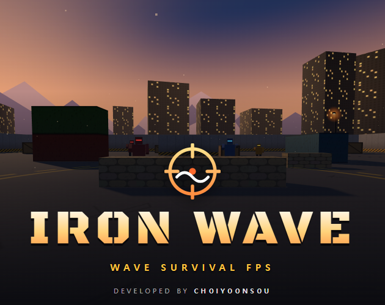
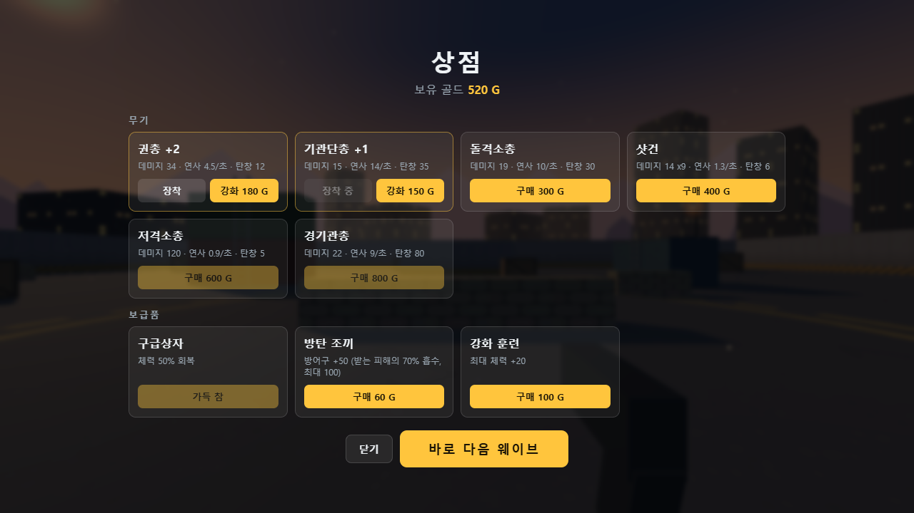
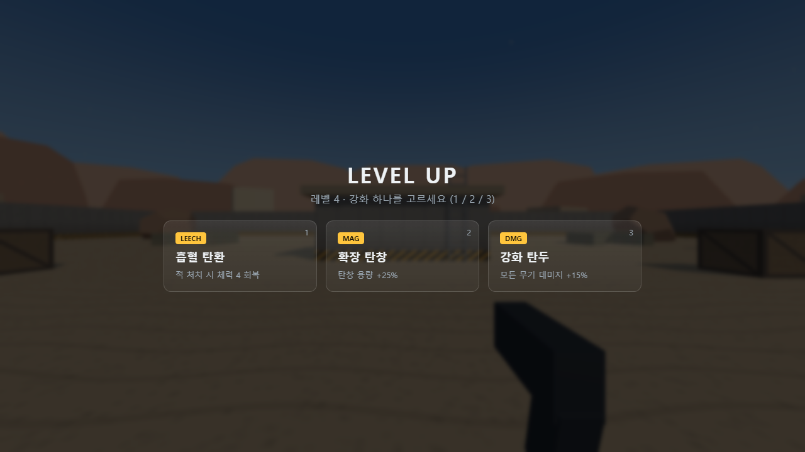

# IRON WAVE

**버티고, 성장하고, 돌파하라.**

웨이브를 버티며 성장하는 FPS 서바이벌 게임이에요. 설치 없이 PC와 모바일 브라우저에서 바로 할 수 있어요.

## ▶ [지금 플레이하기](https://choiyoonsou.github.io/iron-wave/)

## 게임 방식

한 판은 세 개의 전장을 차례로 돌파하는 여정이에요. 웨이브를 버티고, 싸움 사이사이 캐릭터를 키워서 다음 전장으로 나아가요.

1. **웨이브를 버티세요.** 맵 가장자리에서 적이 몰려와요. 엄폐물을 쓰고, 높은 곳에 올라가고, 계속 움직이세요.
2. **레벨업하세요.** 적을 처치하면 경험치가 쌓여요. 레벨업할 때마다 게임이 멈추고 **강화 카드 3장 중 1장**을 골라요. 데미지, 연사 속도, 흡혈, 치명타, 자동 회복 등이 있어서 매 판 다른 빌드가 만들어져요.
3. **웨이브 사이에 상점을 이용하세요.** 적을 처치하면 골드도 떨어져요. 웨이브를 깨면 상점에서 새 무기를 사거나, 가진 무기를 강화하거나, 방탄 조끼와 구급상자를 살 수 있어요.
4. **보스를 쓰러뜨리세요.** 스테이지마다 5번째 웨이브에 그 전장만의 보스가 나와요. 보스를 잡으면 다음 전장으로 넘어가요.
5. **더 강해진 적과 다시.** 3스테이지를 모두 깨면 더 강한 적과 함께 2회차가 시작돼요.

| 상점 | 레벨업 |
|---|---|
|  |  |

## 전장

| 노을 항구 | 사막 기지 | 폐허 도시 |
|---|---|---|
|  |  |  |
| 해 질 녘, 쌓아 올린 컨테이너와 모래주머니 방어선 | 한낮의 탁 트인 사막, 벙커와 감시탑. 빠른 적이 많아요 | 밤의 폐허, 불탄 차와 무너진 벽. 원거리 적이 많아요 |

## 무기

| 무기 | 가격 | 특징 |
|---|---|---|
| 권총 | 기본 지급 | 정확한 단발 사격 |
| 기관단총 | 150 G | 아주 빠른 연사, 짧은 사거리 |
| 돌격소총 | 300 G | 어디서나 무난한 만능형 |
| 샷건 | 400 G | 9발 산탄, 근거리에서 강력 |
| 저격소총 | 600 G | 엄청난 한 방, 스코프 줌 |
| 경기관총 | 800 G | 80발 탄창으로 쉬지 않고 사격 |

모든 무기는 **+5**까지 강화할 수 있어요(1단계마다 데미지 +15%).

## 적

- **돌격병:** 곧장 달려와 근접 공격을 해요.
- **추적자:** 작고 빠르지만 약해요.
- **사수:** 거리를 두고 피할 수 있는 주황색 탄을 쏴요.
- **보스:** 두꺼운 장갑, 근접 강타, 5갈래 산탄 공격을 해요.

옥상에 숨어 있으면 근접 적이 **점프해서 따라 올라와요.** 높은 곳은 시간을 벌어 줄 뿐, 안전지대는 아니에요.

## 조작법

| | PC | 모바일 |
|---|---|---|
| 이동 | WASD (Shift 달리기) | 왼쪽 조이스틱 |
| 조준 | 마우스 | 오른쪽 화면 드래그 |
| 사격 | 왼쪽 클릭 | 사격 버튼 (누른 채 드래그하면 조준도 돼요) |
| 정조준 | 오른쪽 클릭 | 조준 버튼 |
| 점프 | Space | 점프 버튼 |
| 재장전 | R | 장전 버튼 |
| 무기 교체 | 1~6 / 마우스 휠 | 무기 버튼 |
| 상점 (웨이브 사이) | B | 상점 버튼 |
| 사다리 오르기 | 사다리 쪽으로 걷기 | 조이스틱을 사다리 쪽으로 밀기 |

모바일에는 **조준 보정**이 살짝 들어가 있어요. **AUTO** 버튼을 켜면 조준점이 적에 닿을 때 자동으로 사격해요.

---

**English:** A wave-survival FPS that runs in your browser on PC and mobile. Survive the waves, pick upgrade cards, buy and upgrade guns, and beat the boss of each battlefield. [Play now](https://choiyoonsou.github.io/iron-wave/)

© Choiyoonsou. All rights reserved.
