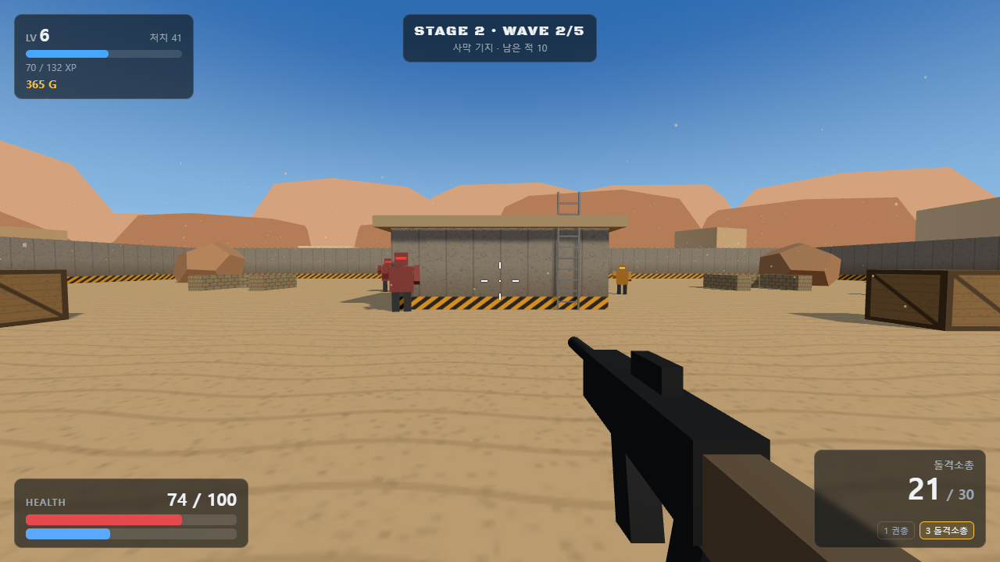
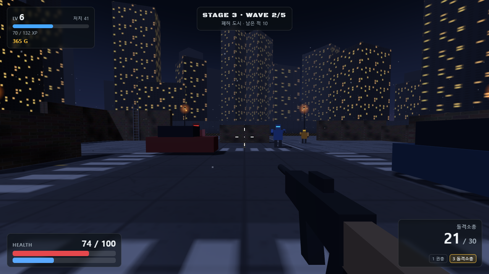

# IRON WAVE

**Hold the line. Level up. Break through.**

A wave-survival FPS that runs right in your browser, on PC and on mobile. No install needed.

## ▶ [Play now](https://choiyoonsou.github.io/iron-wave/)

## How it plays

Each run is a march through three battlefields. Survive the waves, grow your soldier between fights, and push on to the next zone.

1. **Survive the wave.** Enemies pour in from the edges of the map. Use cover, climb to high ground, and keep moving.
2. **Level up.** Kills give XP. On every level-up the game pauses and you pick **1 of 3 upgrade cards**: damage, fire rate, lifesteal, crit chance, regeneration and more. No two runs build the same way.
3. **Shop between waves.** Kills also drop gold. When a wave is cleared, open the shop to buy new weapons, upgrade the ones you own, or stock up on armor and med kits.
4. **Beat the boss.** Wave 5 of every stage brings a unique boss. Defeat it to move to the next battlefield.
5. **Go again, harder.** After stage 3 the cycle starts over with tougher enemies.

| Shop | Level-up |
|---|---|
|  |  |

## Battlefields

| Sunset Harbor | Desert Outpost | Ruined City |
|---|---|---|
|  |  |  |
| Stacked shipping containers and sandbag lines at dusk | Open sand, a bunker and watchtowers under the midday sun. Fast runners | Burnt-out cars and broken walls at night. Lots of gunners |

## Arsenal

| Weapon | Price | Style |
|---|---|---|
| Pistol | Starter | Accurate, semi-auto |
| SMG | 150 G | Very fast fire rate, short range |
| Assault Rifle | 300 G | All-rounder |
| Shotgun | 400 G | 9 pellets, devastating up close |
| Sniper Rifle | 600 G | Huge damage, scope zoom |
| LMG | 800 G | 80-round belt, keeps firing |

Every weapon can be upgraded up to **+5** (+15% damage per level).

## Enemies

- **Grunt**: walks straight at you and hits hard up close
- **Runner**: small, fast, and fragile
- **Gunner**: keeps its distance and fires slow orange shots you can dodge
- **Boss**: heavy armor, melee slams and a 5-way spread shot

Melee enemies **leap after you** if you camp on a rooftop, so high ground buys time but doesn't make you safe.

## Controls

| | PC | Mobile |
|---|---|---|
| Move | WASD (Shift to sprint) | Left-side joystick |
| Aim | Mouse | Drag on the right side |
| Shoot | Left click | FIRE button (drag while holding to aim) |
| Aim down sights | Right click | ADS button |
| Jump | Space | JUMP button |
| Reload | R | RELOAD button |
| Switch weapon | 1–6 / mouse wheel | Weapon button |
| Shop (between waves) | B | Shop button |
| Climb a ladder | Walk into it | Push the joystick toward it |

On mobile you also get light **aim assist**, and an **AUTO** button that fires automatically when your crosshair is on an enemy.

---

## 한국어

웨이브를 버티며 성장하는 **FPS 서바이벌** 게임이에요. PC와 모바일 브라우저에서 설치 없이 바로 할 수 있어요.

**게임 방식**
1. 맵 가장자리에서 몰려오는 적을 엄폐물과 높은 곳을 활용해 막아내요.
2. 적을 처치하면 경험치가 쌓이고, 레벨업할 때마다 **강화 카드 3장 중 1장**을 골라요.
3. 웨이브 사이에 **상점**에서 골드로 무기를 사고 강화하고, 방탄 조끼와 구급상자를 사요.
4. 스테이지마다 5번째 웨이브에 **보스**가 나와요. 보스를 잡으면 다음 전장으로 넘어가요.
5. 노을 항구, 사막 기지, 폐허 도시를 모두 돌파하면 더 강해진 적과 2회차가 시작돼요.

**조작**: PC는 WASD, 마우스, 클릭, 우클릭(정조준), R(재장전), B(상점)을 써요. 모바일은 왼쪽 조이스틱, 오른쪽 드래그 조준, 화면 버튼을 써요.

---

© Choiyoonsou. All rights reserved.
